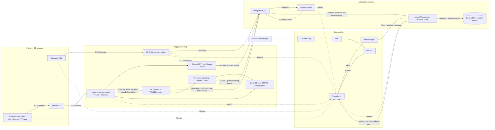
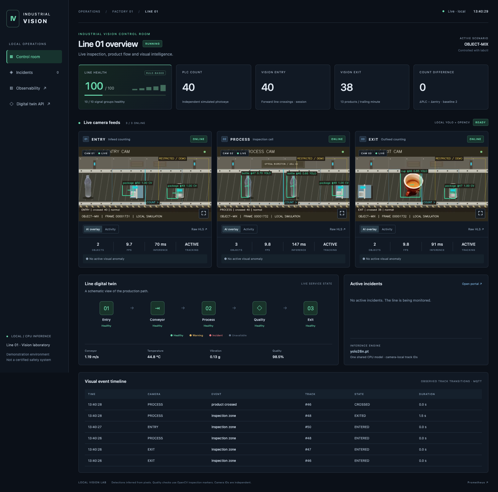

# Computer Vision — Industrial AI & OT Monitoring Platform

> A fully local industrial AI simulation combining computer vision, OPC-UA, MQTT, machine learning, observability and incident management.


[](LICENSE)

**[Overview](#overview) · [Architecture](#architecture) · [Quick start](#quick-start) · [Services / URLs](#services-and-interfaces) · [Demo](#demo) · [Scenarios](#failure-scenarios) · [Control Room](#industrial-vision-control-room) · [Multi-camera](#multi-camera-industrial-vision) · [Incidents](#incident-management) · [Tests](#validation)**

## Overview

This project connects a simulated production line to an operational monitoring stack. A Python PLC exposes machine data through OPC-UA, three logical cameras publish real RTSP video, and edge services turn telemetry and images into MQTT events. Local machine learning detects unusual process data, while Prometheus, Grafana, Loki and Alertmanager bring together metrics, logs, alerts and incident notifications.

The environment runs in Docker Compose with separate OT and application networks. It is designed to demonstrate the engineering work between a sensor reading and an actionable incident: protocol integration, video processing, service recovery, data freshness and fault diagnosis.

The original idea was inspired by modern industrial AI and computer vision platforms, including systems developed by companies such as Cerrion. This repository is an independent personal project built from scratch for learning, experimentation and portfolio purposes. It has no affiliation with that company and contains none of its proprietary code, architecture, models, datasets or internal information.

**No cloud account, paid API, external model service or API key is required.** The first build downloads open-source dependencies; runtime processing and inference stay local.

## 💡 Why I Built This

I built this project to explore the intersection of cloud engineering, DevOps, SRE, machine learning and industrial systems. I wanted an end-to-end environment where industrial telemetry, computer vision, networking, observability and incident response work together.

It helps me deepen hands-on knowledge of industrial AI, computer vision, OPC-UA and OT networks, local ML inference, observability and infrastructure troubleshooting.

## 🎥 What the platform simulates

Products move along a synthetic conveyor while two complementary views of the line are monitored:

- **Machine telemetry:** conveyor speed, motor temperature, vibration, production count, blocked sensor, quality score and line status.
- **Camera observations:** bottles, cups, parcels and a person-zone demonstration, plus red jam obstruction, reduced brightness, blur, lens obstruction and stream loss.

OpenCV analyzes decoded video frames while a local YOLO26n model detects semantic objects. An IsolationForest model evaluates incoming process telemetry. Prometheus evaluates alert rules, Alertmanager delivers firing and resolved notifications, and a local FastAPI Incident Management portal correlates notifications and persists their lifecycle, evidence and reports in PostgreSQL. Grafana provides a provisioned view of the process, network health, anomalies, incidents and container logs.

### Architecture



`opcua-sim`, `camera-sim` and `mediamtx` live on **`ot_net`**. The bridge and CV detector join both **`ot_net`** and **`cloud_net`**; backend services primarily use `cloud_net`. Prometheus, Blackbox Exporter and the optional tools container also join both networks to observe OT endpoints. PostgreSQL uses the internal `incident_net`; only the incident service and optional tools container join that database network. PostgreSQL has no host port binding.

This makes it possible to disconnect an edge service from OT while preserving its application connection and leaving the PLC running. Docker networks demonstrate logical segmentation; they do not replace industrial firewalls, VLANs or a plant DMZ.

## Engineering focus

| Area | Demonstrated capabilities |
|---|---|
| Industrial IoT / OT | OPC-UA address spaces, dynamic namespace resolution, subscriptions, secure channels and network-path isolation |
| Computer vision / ML | RTSP decoding, interpretable image statistics, reproducible model training and per-message inference |
| DevOps / platform engineering | Containerized Python services, Compose networks, persistent volumes, automatic provisioning and CI checks |
| SRE / incident response | Dependency retries, freshness metrics, HTTP/TCP probes, alert routing, log correlation and recovery testing |

## Quick start

### Requirements

- Docker Engine with Compose **v2.17 or later** and BuildKit, or current Docker Desktop (the CV build uses an additional service build context).
- Plan for approximately **6–8 GB of memory** available to Docker and several GB of disk space.
- Git to clone the repository. **Python 3 on the host is needed only for the scenario scripts and integration runner**, not for the main stack.
- Internet access for the initial image and package downloads.

Replace `<repository-url>` with this repository's actual clone URL:

```bash
git clone <repository-url>
cd computer-vision
docker compose up -d --build
docker compose ps
docker compose --profile tools run --rm tools python /tools/smoke_test.py
```

Allow services to initialize before exploring the dashboard. The smoke test retries checks and expects the platform to be in its normal state.

Open the **[Industrial Vision Control Room](http://localhost:8083/)** for live cameras, tracking and the line overview. Open **[Grafana](http://localhost:3000)** and sign in with **`admin` / `admin`**. The **Industrial Computer Vision & OT Lab** dashboard and its Prometheus/Loki data sources are provisioned automatically. The dashboard UID is `industrial-computer-vision`.

No `.env` file is required. [.env.example](.env.example) documents optional project, logging, YOLO and preview settings. YOLO is enabled by default; weights download only during the image build. All published ports bind to **127.0.0.1**; the credentials are for local use only.

<a id="demo"></a>

## 📸 Demo

Prepare a live production jam for screenshots:

```bash
./scripts/demo_screenshots.sh jam
```

The helper starts the stack, records a normal baseline, invokes the existing scenario controller, and waits for jam metrics and firing alerts before printing the camera, Grafana, Alertmanager and incident URLs. It prepares the demo; screenshots are captured manually. Python 3 and Docker are required.

The original jam screenshot gallery below remains pending. A current Control Room capture appears in the multi-camera section. The intended jam gallery follows the incident from the camera to operational impact and alert propagation:

| View | What to capture | Save as |
|---|---|---|
| Synthetic camera | A red obstruction on the conveyor during a production jam | `docs/images/camera-jam.png` |
| Grafana | Blocked line, conveyor speed drop, increased vibration, reduced quality and CV/ML anomalies | `docs/images/grafana-jam.png` |
| Alertmanager | Firing production, vision and ML alerts | `docs/images/alertmanager-jam.png` |

<!-- SCREENSHOT GALLERY: Enable only after all three real PNG files exist.
Replace the pending-images note and checklist above with this gallery.

### Production jam detected by the synthetic camera


A visible obstruction connects the camera scene to the simulated blocked-line condition.

### Operational impact in Grafana


Process metrics, vision signals and ML inference show the operational impact of the same incident.

### Alert propagation


Firing alerts make the detected conditions visible to the incident-response workflow.
-->

See the [capture guide](docs/images/README.md) for exact views, Grafana settings and gallery activation. On macOS, `./scripts/demo_screenshots.sh jam --open` optionally opens the URLs. Windows users can run `./scripts/demo_screenshots.ps1 jam`.

When finished, run `./scripts/demo_screenshots.sh normal` (or the PowerShell equivalent). The helper leaves the jam active until you restore normal operation.

## ▶️ Demo Flow

Open the [camera view](http://localhost:8888/line1/), [Grafana](http://localhost:3000) and the [Incident Portal](http://localhost:8090/), then run from the started stack:

```bash
./scripts/labctl.sh normal
./scripts/labctl.sh jam
```

The conveyor slows, the blocked sensor activates and a red object appears in the video. OpenCV detects the obstruction and ML flags the changed process telemetry. Allow roughly 40 seconds for the related alerts to reach the portal. Open **Production Line Jam** to inspect its correlated alerts, actual evidence and timeline, then acknowledge it and start an investigation. Add root-cause/impact notes and record the actions you actually take.

Restore normal operation:

```bash
./scripts/labctl.sh normal
```

After the source alerts recover, the incident automatically resolves following the default 30-second quiet period. Open [Incident History](http://localhost:8090/history) to inspect the retained timeline and download its final JSON or Markdown report. Manual resolution is also available after all underlying alerts recover.

On Windows, use `./scripts/labctl.ps1 jam` and `./scripts/labctl.ps1 normal` in PowerShell. Both wrappers call the same Python controller.

## Services and interfaces

The default stack contains **15 running services**, plus an on-demand `tools` service.

| Service | Role | Local interface / published ports |
|---|---|---|
| `opcua-sim` | PLC simulation and control | OPC-UA `4840` · [API docs](http://localhost:8081/docs) · [metrics](http://localhost:9101/metrics) |
| `camera-sim` | Synthetic conveyor video | [API docs](http://localhost:8082/docs) · [metrics](http://localhost:9105/metrics) |
| `mediamtx` | RTSP and HLS distribution | RTSP `8554` · [HLS video](http://localhost:8888/line1/) |
| `telemetry-bridge` | OPC-UA reads → MQTT | [Metrics](http://localhost:9102/metrics) |
| `cv-detector` | Multi-camera OpenCV, shared YOLO, tracking and Control Room | [Control Room](http://localhost:8083/) · [Process MJPEG](http://localhost:8083/annotated.mjpg) · [JPEG snapshot](http://localhost:8083/snapshot.jpg) · [health](http://localhost:8083/healthz) · [metrics](http://localhost:9104/metrics) |
| `ml-anomaly` | Telemetry inference → MQTT and metrics | [Metrics](http://localhost:9103/metrics) |
| `mqtt` | Eclipse Mosquitto broker | MQTT `1883` |
| `prometheus` | Metrics and alert evaluation | [localhost:9090](http://localhost:9090) |
| `blackbox-exporter` | HTTP and TCP probes | [localhost:9115](http://localhost:9115) |
| `alertmanager` | Alert grouping and webhook delivery | [localhost:9093](http://localhost:9093) |
| `incident-receiver` | Persistent incident lifecycle, correlation and reports | [Incident Portal](http://localhost:8090/) · [active](http://localhost:8090/incidents) · [history](http://localhost:8090/history) · [statistics](http://localhost:8090/statistics) · [API](http://localhost:8090/docs) · [metrics](http://localhost:9106/metrics) |
| `incident-db` | PostgreSQL incident history | Internal Docker network only; no published database port |
| `loki` | Local log storage | [Readiness](http://localhost:3100/ready) |
| `alloy` | Docker log discovery and collection | [localhost:12345](http://localhost:12345) |
| `grafana` | Provisioned operations dashboard | [localhost:3000](http://localhost:3000) |
| `tools` | Protocol clients and smoke tests | Compose profile `tools`; no published ports |

Open the HTTP links in a browser. Grafana uses **`admin` / `admin`**. Loki exposes a readiness endpoint; browse its logs through Grafana Explore using the provisioned Loki data source. The bridge and ML service expose metrics rather than a separate web interface.

Application metrics are available at `/metrics` on ports `9101`–`9106`. MQTT and OPC-UA require compatible protocol clients; RTSP can be opened in VLC or another RTSP player:

```text
OPC-UA  opc.tcp://localhost:4840/computer-vision/server/
MQTT    mqtt://localhost:1883
RTSP    rtsp://localhost:8554/line1
HLS     http://localhost:8888/line1/
MJPEG   http://localhost:8083/annotated.mjpg
JPEG    http://localhost:8083/snapshot.jpg
```

HLS playback has more latency than RTSP and depends on browser support.

## Failure scenarios

Run any command below with `./scripts/labctl.sh <command>` or `./scripts/labctl.ps1 <command>`.

| Command | Behavior |
|---|---|
| `normal` | Restore PLC/cameras/OT paths, clear overrides, reset scenarios and explicitly start a fresh reconciliation baseline; vision counters are retained |
| `object-mix` | Photographic bottles/cups plus marked parcels and cans; semantic YOLO detections and OpenCV marker ROIs are distinguished |
| `person-zone` | A photographic person sprite overlaps the configured restricted zone; actual person inference triggers demo events |
| `fallen-object` | A bottle lies rotated on the walkway; its known cyan marker is inspected by OpenCV, without a pretrained “fallen” class |
| `crowded-line` | Denser product spacing and local tracks; occlusion can reduce counting accuracy; no crowd classifier is claimed |
| `stalled-product` | Freeze products in the process view while PLC expects motion; infer stationary tracks and excessive dwell |
| `wrong-direction` | Reverse products in the process view; infer sustained negative track velocity |
| `misaligned-product` | Rotate process products with horizontal inspection fiducials; derive an OpenCV orientation failure |
| `count-mismatch` | Model PLC photoeye bounce and alternate missing exit products; derive PLC/vision and aggregate flow discrepancies |
| `jam` | Block the line, slow the conveyor, increase vibration, reduce quality and display a red obstruction |
| `overheat` | Set motor temperature to 95 °C; keep the camera normal |
| `vibration` | Set motor vibration to 1.2 g |
| `quality-drop` | Reduce quality score to 0.65 |
| `stopped` | Stop the conveyor and set line status to `STOPPED` |
| `dirty-camera`, `dark-camera`, `blur-camera` | Change the camera image without modifying PLC telemetry |
| `camera-offline`, `camera-online` | Stop/start all three views while MediaMTX stays available |
| `opcua-down`, `opcua-up` | Stop/start the PLC simulator; exercise bridge reconnection |
| `edge-ot-cut`, `edge-ot-restore` | Remove/restore only the bridge's OT network connection |
| `cv-ot-cut`, `cv-ot-restore` | Remove/restore only the CV detector's OT network connection |
| `state` | Show Compose service status and PLC/camera API state |

PLC scenarios reset the camera to normal except for `jam`, which changes both sources. Network operations discover resources through Compose labels rather than fixed container names.

For a network diagnosis example, inject `edge-ot-cut` and compare `bridge_opcua_connected` with `probe_success{instance="opcua-sim:4840"}`. The bridge loses access even though Blackbox can still reach the PLC. **Endpoint availability and end-to-end connectivity are different signals.**

<details>
<summary>Manual PLC overrides and dependency recovery</summary>

```bash
curl -X POST http://localhost:8081/override/MotorTemperature \
  -H 'Content-Type: application/json' \
  -d '{"value":105}'

curl -X DELETE http://localhost:8081/overrides
```

The PLC and camera APIs also expose `GET /healthz`, `GET /state` and `POST /scenario/{name}`. The camera health endpoint describes its control plane; `camera_publisher_up` and `cv_stream_up` describe video-path health.

To restore after manually stopping MQTT or MediaMTX, start those dependencies before resetting the scenarios:

```bash
docker compose start mediamtx mqtt
./scripts/labctl.sh normal
```

</details>

<a id="multi-camera-industrial-vision"></a>

## 🎥 Multi-Camera Industrial Vision

Three logical views observe a shared, timestamp-driven conveyor scene at 640×360 and a target 10 fps. Entry, process and exit are spaced along a common simulated world; normal products advance at 50 pixels/s with 220-pixel spacing. Steel conveyors, photoeyes, an inspection cell, trays, bottles, marked parcels, cans and cups form a lightweight industrial scene. `object-mix` shows the full product mix. The process-only station faults demonstrate local inspection conditions; this is not a full material-flow physics model.

| Camera | Raw RTSP | Raw HLS | Annotated MJPEG |
|---|---|---|---|
| Entry | `rtsp://localhost:8554/line1-entry` | [Entry HLS](http://localhost:8888/line1-entry/) | [Entry AI](http://localhost:8083/cameras/entry/annotated.mjpg) |
| Process | `rtsp://localhost:8554/line1-process` | [Process HLS](http://localhost:8888/line1-process/) | [Process AI](http://localhost:8083/cameras/process/annotated.mjpg) |
| Exit | `rtsp://localhost:8554/line1-exit` | [Exit HLS](http://localhost:8888/line1-exit/) | [Exit AI](http://localhost:8083/cameras/exit/annotated.mjpg) |

For each camera, `/cameras/<camera>/snapshot.jpg` returns an annotated JPEG and `/cameras/<camera>/heatmap.jpg` returns accumulated, decaying OpenCV frame-difference activity. The heatmap is a visualization, not an alert. `line1` remains a MediaMTX alias of the process feed. No extra Compose service or model per camera is introduced.

## 🎯 Object Tracking

A lightweight **class-gated constant-velocity tracker with global minimum-cost assignment** tracks real YOLO boxes independently in each view. SciPy’s assignment solver is already part of the CPU scientific stack; no additional tracking model, re-identification model or runtime download is required. Two observations confirm a track; unmatched tracks expire after two seconds. IDs increase during the CV process lifetime and are not shared across cameras.

Tracks report position, direction, speed in **pixels/s**, observed duration, inspection-zone transitions and dwell. With fresh PLC telemetry expecting motion, a product moving less than 14 pixels over the default five-second history triggers `object_stalled`. Sustained reverse velocity below −12 pixels/s for two seconds triggers `wrong_direction`; inspection dwell beyond 13 seconds triggers `excessive_dwell`. These are temporal rules over inferred boxes, not pretrained YOLO defect classes. Crossing/occlusion can fragment IDs or produce count errors; this is not industrial metrology.

OpenCV independently segments known **cyan inspection fiducials**. A horizontal marker with aspect ratio over five indicates an orientation defect; a marked product below the conveyor indicates an out-of-conveyor defect. Marked package ROIs are labeled `CV`, with deterministic presence score 1.0, not a learned probability. `misaligned-product` and `fallen-object` exercise this mechanism. No custom damage, missing-label or wrong-color classifier is claimed.

## 📦 Vision-Based Production Counting

Entry and exit count confirmed non-person tracks crossing x=320 in the forward direction, at most once per track. `vision_products_entered_total` and `vision_products_exited_total` are genuine Prometheus counters: scenario changes, camera restarts and RTSP reconnects do not reset them; restarting the CV process does. IDs also stay monotonic through stream reconnects.

`vision_products_in_process` is a **gauge of unmatched observed entries**, not a measurement of initial physical inventory. The flow estimator ignores startup exits until a new entry could reach exit (minimum 20 seconds; nominal simulated transit 22.4 seconds). An unmatched entry older than 45 seconds creates a possible aggregate missing-exit signal. There is no cross-camera product re-identification. `vision_product_flow_per_minute` is the number of exit crossings in the trailing 60 seconds; the first minute is a partial window.

The PLC independently counts simulated photoeye crossings at the same nominal cadence (one product per 4.4 seconds); it never reads detector results. `vision_plc_count_difference = ΔPLC BottleCount − Δvision entry count` compares deltas from a fresh observation baseline. The default tolerance is three products for 15 seconds before the derived signal activates. `count-mismatch` models a bouncing PLC sensor and removes alternate exit products; the alert reads actual measured count differences, not the scenario name.

Stream/inference loss, degraded entry/exit images, stale telemetry or a PLC that is stopped/blocked makes reconciliation unavailable (`NaN` difference in metrics, `null` in JSON). Recovery and PLC counter rollback create a new baseline epoch. `normal` explicitly starts a new observation session via `POST /api/reconciliation/reset`, retaining lifetime vision counters. Historical count incidents remain in PostgreSQL. A baseline reset is a synchronization action, not proof that lost products were recovered.

| Setting | Default | Purpose |
|---|---|---|
| `VISION_STALLED_SECONDS` | `5` | Near-stationary observation window |
| `VISION_DWELL_SECONDS` | `13` | Inspection dwell threshold |
| `VISION_COUNT_TOLERANCE` | `3` | Allowed PLC/vision count difference |
| `VISION_COUNT_HOLD_SECONDS` | `15` | Difference persistence before signal |
| `VISION_MISSING_EXIT_SECONDS` | `45` | Maximum unmatched entry age |

## 🦺 Restricted Zone Monitoring

`YOLO_RESTRICTED_ZONE` configures a normalized rectangle, rendered in each annotated view. Real inferred person boxes and local tracks produce **ENTERED**, periodic **PRESENT**, and **EXITED** events with dwell time. EXITED can also mean track expiry; lost tracking does not prove a person physically left. The original untracked `cv/safety` topic remains available, while `vision/safety` carries tracked transitions.

This is a visual demonstration, not a certified industrial safety system or machine interlock.

<a id="industrial-vision-control-room"></a>

## 🖥️ Industrial Vision Control Room

Open **[http://localhost:8083/](http://localhost:8083/)**. The FastAPI/Jinja2 UI uses local CSS, minimal JavaScript and system fonts. It displays three live annotated camera panels, availability, observed objects, FPS, inference latency, tracking state, anomalies, PLC/vision counts, the deterministic health score, actual active incidents and recent MQTT visual transitions. Each camera can switch between AI overlay and activity heatmap or open raw HLS. Grafana remains the observability interface.



The read-only JSON state is [GET /api/state](http://localhost:8083/api/state). One shared CPU model processes about two sampled frames/s per view. Per-camera queues have capacity one, generation guards reject results from lost streams, and stale tracking flags clear independently of raw camera health.

For the end-to-end stalled-product demo, leave the Control Room, Grafana and [Incident Portal](http://localhost:8090/incidents) open:

```bash
./scripts/labctl.sh normal
./scripts/labctl.sh stalled-product
# Wait about 20–40 seconds: tracked stall → Prometheus → incident and visual state.
./scripts/labctl.sh normal
```

## 🏭 Digital Twin

The Control Room includes a **2D schematic**: Entry → Conveyor → Process → Quality → Exit. [GET /api/twin](http://localhost:8083/api/twin) returns actual nodes, edges and component state. Green is healthy, yellow warning, red incident and gray unavailable. Camera frames, tracking/image signals and fresh PLC readings determine these states; the diagram is not a 3D engine or physical simulation.

The rule-based line-health score is the sum of earned component weights, with **false or unknown signals earning zero**:

| Component | Points earned when healthy |
|---|---|
| Fresh PLC telemetry (<8 s) | 15 |
| PLC running and conveyor speed >0.1 m/s | 10 |
| Temperature ≤80 °C | 10 |
| Vibration ≤0.5 g | 10 |
| PLC quality ≥0.9 | 10 |
| All camera image/track checks clear and no count/flow mismatch | 10 |
| YOLO loaded and fresh tracking updates on all views | 10 |
| All three raw cameras fresh (<3 s) | 10 |
| Fresh ML result (<15 s), not anomalous | 5 |
| Seven independent endpoint probes and bridge connectivity healthy | 10 |

The 0–100 score is exported as `factory_line_health_score` and alias `vision_line_health_score`, with the formula components in `/api/state`. It is an operations heuristic, not an AI prediction. The MQTT visual topics are `factory/line1/vision/events`, `/counts`, `/safety` and `/quality`; IDs appear only in event payloads, never Prometheus labels. Incident enrichment samples these topics while Alertmanager remains the incident trigger.

New bounded-camera metrics include `vision_camera_up`, `vision_objects_detected`, `vision_tracking_ready`, `vision_effective_fps`, `vision_inference_latency_seconds`, `vision_tracking_latency_seconds`, `vision_dropped_frames_total`, `vision_skipped_frames_total`, `vision_last_frame_timestamp_seconds`, `vision_last_processed_frame_timestamp_seconds`, `vision_restricted_zone_violation`, `vision_quality_failure`, `vision_stalled_object_detected`, `vision_wrong_direction_detected` and `vision_excessive_dwell_detected`. Global metrics include counting/flow, `vision_count_reconciliation_ready`, `vision_count_mismatch`, `vision_missing_exit_detected` and `vision_count_epoch`. Frame timestamps are decoder receipt times, not calibrated sensor capture times.

Prometheus adds `ProductStalled`, `ProductWrongDirection`, `ProductExcessiveDwell`, `ProductionCountMismatch`, `ProductMissingExit`, `VisualQualityFailure`, `VisionCameraUnavailable` and `VisionPersonInRestrictedZone`. Stall/dwell share a process-tracking incident family and join a nearby production-jam anchor; count/missing-exit share a count family. Both tracked and original person-zone alerts share the restricted-zone family. All three camera outages join the existing camera-connectivity incident.

## 🧠 Multi-layer Detection

The platform combines three complementary detection layers:

1. **Classical Computer Vision:** deterministic OpenCV statistics detect the synthetic red jam, darkness, blur, dirty/obstructed view and stream loss. These checks still run on every acquired frame, independently of YOLO.
2. **Deep Learning vision:** CPU-only YOLO26n produces real object classes, bounding boxes and confidence scores from decoded RTSP frames. A configurable rectangle demonstrates person/zone intersection. YOLO supplies semantic boxes; temporal tracking and classical marker geometry derive movement/inspection conditions. The pretrained model does not classify factory-specific defects.
3. **Telemetry anomaly detection:** IsolationForest evaluates PLC measurements from OPC-UA via MQTT. It detects unusual combinations of process values independently of camera recognition.

The original raw camera path stays available. `ENABLE_YOLO=false`, missing weights, initialization errors and inference exceptions leave the OpenCV and telemetry pipelines operating. No detection is generated from the scenario name or a hard-coded object location.

## Computer vision and machine learning

### Frame analysis

The camera generates **640 × 360 frames at 10 fps**. FFmpeg encodes H.264 and publishes to MediaMTX over RTSP/TCP; the CV service analyzes actual decoded frames with OpenCV.

| Condition | Detection method | Metric |
|---|---|---|
| Red obstruction | HSV red-pixel ratio > 0.025 | `cv_red_pixel_ratio` |
| Dark image | Mean brightness < 25 | `cv_frame_brightness` |
| Blurred image | Laplacian variance < 30, when not dark | `cv_laplacian_variance` |
| Dirty/obstructed view | Center-to-border brightness ratio < 0.25, when not dark | `cv_center_to_border_brightness_ratio` |
| Stream unavailable | Frame acquisition fails | `cv_stream_up` |

These CPU-friendly heuristics are interpretable and calibrated to the synthetic scene. They are not a trained object-detection model or a claim of accuracy on real factory cameras.

### Local YOLO object detection

The [Ultralytics YOLO26n](https://docs.ultralytics.com/models/yolo26/) nano detector is pretrained on COCO. Its inspected class list has 80 classes, including `person`, `bottle`, `cup`, `backpack`, `handbag` and `suitcase`; these six form the fixed application allowlist. COCO has no general `box`, `jam` or factory-defect class. Bottles, cups and the person sprite have been verified with actual local model inference; parcels and cans are rendered scene content, without a promised YOLO label. Known cyan package inspection markers can be segmented separately by OpenCV and are explicitly labeled `CV` in overlays.

The camera composites small transparent photographic cutouts over a steel conveyor, animated belt seams, product shadows, rails, fasteners and a striped service walkway. It retains the 640×360 / 10 fps format and every existing scenario. Assets ship locally; provenance, public-domain/CC0 status and modification details are in [SOURCES.md](SOURCES.md).

| Environment variable | Default | Meaning |
|---|---|---|
| `ENABLE_YOLO` | `true` | Enable optional semantic inference |
| `YOLO_MODEL` | `/models/yolo26n.pt` | Existing local weights; no runtime auto-download |
| `YOLO_CONFIDENCE` | `0.45` | Minimum model confidence |
| `YOLO_EVERY_N_FRAMES` | `5` | Submit every fifth acquired frame per camera, about 2 inferences/s per view at 10 fps |
| `YOLO_THREADS` | `2` | PyTorch CPU thread limit |
| `YOLO_RESTRICTED_ZONE` | `0.60,0.16,0.98,0.86` | Normalized rectangle `x1,y1,x2,y2` |
| `YOLO_RESULT_TTL_SECONDS` | `3` | Maximum source-frame age for displayed detections and current gauges |
| `ENABLE_ANNOTATED_STREAM` | `true` | Optional HTTP JPEG/MJPEG annotation; liveness remains available when off |

One worker owns a shared model and three latest-frame slots, one per camera. It selects the oldest pending slot fairly; slow inference replaces queued frames instead of building a backlog. OpenCV acquisition, heuristics and anomaly publishing continue at the original rate. Model/inference failures log an error, set readiness to zero, clear current detections and retry after five seconds. Invalid configuration leaves YOLO unavailable while OpenCV continues. Stream loss invalidates both queued and in-flight results.

A person's inferred bounding box intersecting the restricted rectangle with positive area publishes `person_in_restricted_zone`. This uses bounding-box overlap, not segmentation or a person's precise foot position. **This is an educational demonstration, not a real safety system.** It has no certified safety function, interlock or accuracy guarantee.

The annotated views use local HTTP MJPEG, with per-camera JPEG snapshots. They show image-inferred boxes, class/confidence, local track IDs, velocity arrows, inspection/restricted zones, counting lines, observed counts and anomalies. Box positions use the latest sampled inference and can lag moving objects. Raw and inference freshness expire independently after three seconds; stale JPEG snapshots return HTTP 503. The legacy [process MJPEG](http://localhost:8083/annotated.mjpg), [snapshot](http://localhost:8083/snapshot.jpg), [raw HLS](http://localhost:8888/line1/) and `rtsp://localhost:8554/line1` remain available. Annotated RTSP publishers are deliberately replaced by the supported simpler MJPEG option.

Run the demo from this repository root. Execute scenario changes one at a time and observe the video/dashboard between them; allow about 20–30 seconds for alerts to propagate. The [complete test sequence](#validation) also covers repository checks and automated failure recovery.

```bash
docker compose up -d --build
make normal
make yolo-test
make object-mix
make person-zone
# Open http://localhost:8083/annotated.mjpg and Grafana's YOLO section.
# Allow ~20 seconds for the person alert to reach the incident feed.
make crowded-line
make fallen-object
make jam
make normal
make smoke
```

The PowerShell wrapper accepts the same commands. `tools/yolo_test.py` uses the actual local model and licensed person-zone scene, requires a genuine person/zone result, prints all model classes and reports warm inference latency. It is optional and excluded from normal unit tests/CI; `--image /path/to/local/image` supports another licensed local test image.

To switch YOLO off without editing files:

```bash
ENABLE_YOLO=false docker compose up -d --no-deps --no-build cv-detector
./scripts/labctl.sh jam
# Observe the raw/annotated video or CV metrics before restoring normal.
./scripts/labctl.sh normal
docker compose --profile tools run --rm tools python /tools/smoke_test.py
# Restore the default (unless your .env overrides it):
ENABLE_YOLO=true docker compose up -d --no-deps --no-build cv-detector
docker compose --profile tools run --rm tools python /tools/smoke_test.py
```

In PowerShell use `$env:ENABLE_YOLO='false'` before `docker compose up -d --no-deps --no-build cv-detector`, then set it to `'true'` to restore.

The two Dockerfiles and dependency files form a shared base and a CV extension:

| File | Purpose |
|---|---|
| `requirements.txt` | Shared Python dependencies used by the existing services |
| `Dockerfile` | Builds the shared non-root Python image using `requirements.txt` |
| `requirements-cv.txt` | Additional Ultralytics, PyTorch and Torchvision dependencies; their versions are defined here |
| `Dockerfile.cv` | Extends the shared image through Compose's `lab-base` build context, installs CPU wheels and downloads the checksummed model at build time |

Other services keep using the shared image; only the CV image adds headless Ultralytics, CPU PyTorch and the ~5.3 MiB model. Python remains 3.12; no CUDA image or GPU is required. Build-time weights have a pinned SHA-256. `YOLO_OFFLINE=true`, disabled integrations, local-file loading and array inputs keep runtime inference offline. To use other trusted weights, mount them into the CV container and set `YOLO_MODEL` to that path.

The earlier single-camera validation averaged about **77 ms at 1.9 inferences/s** while raw video remained near its 10 fps target. These are historical single-camera measurements; current multi-camera measurements are recorded in [MULTICAMERA_VALIDATION.md](docs/MULTICAMERA_VALIDATION.md). An isolated 20-run CPU benchmark averaged 60 ms; CPU and memory cost vary with host load. See the [measurement record](docs/YOLO_VALIDATION.md) for methods, image sizes and limits.

### Process anomaly detection

The ML service trains **scikit-learn IsolationForest** at startup on 4,000 synthetic normal observations with seed `42`, 160 trees and contamination `0.12`. It evaluates each telemetry message using `ConveyorSpeed`, `MotorTemperature`, `Vibration`, `QualityScore` and `BlockedSensor`.

`ml_anomaly_score` is the negative of `decision_function`: **positive values indicate an anomaly**. It is not a probability. The contamination setting selects a sensitive boundary within the training distribution; it does not represent a measured factory failure rate.

False positives and false negatives are possible, including intermittent misses during overheating. Deterministic process alerts remain independent of ML. The model demonstrates local inference integrated into an OT pipeline, not production-grade anomaly detection.

<a id="incident-management"></a>

## 🚨 Incident Management

Alert detection → correlation → incident → investigation → remediation → resolution → post-incident report.

The [Incident Management Portal](http://localhost:8090/) is the operational interface for incident response and historical records. **Grafana** remains the technical observability interface; **Alertmanager** routes firing/resolved alerts; the **Incident Portal** owns correlation, operator workflow and reports. Navigation links connect these local tools, including raw HLS and the annotated camera. The portal uses FastAPI, server-rendered Jinja2 and local CSS/JavaScript, without a Node/React application stack, remote fonts or an external incident platform. Interactive `/docs` uses locally vendored Swagger UI assets with the external validator disabled.

### Persistence and startup

PostgreSQL **18.6** stores incident history in the named `incident-db-data` Docker volume. The database lives on the internal `incident_net` and has no published host port. `incident-receiver` waits for its database health check, then runs the versioned schema migration automatically. Migration version 1 creates:

| Table | Stored information |
|---|---|
| `incidents` | Public number (`INC-000001`), category, severity, operator status, site/line, lifecycle timestamps, root-cause suggestion/notes, impact, remediation and MTTA/MTTR |
| `alert_occurrences` | Actual Alertmanager fingerprint/labels, startsAt epoch, firing/resolved state, annotations and receipt/recovery timestamps |
| `incident_events` | Source events, correlation decisions, operator transitions and notes, with timestamped evidence |
| `signals` | Latest sampled PLC, OpenCV, YOLO, safety, ML and monitoring payloads per site/line |
| `incident_evidence` | Actual source snapshots associated with an incident; original timestamps and payloads retained |
| `incident_reports` | Immutable final JSON and Markdown snapshots generated at resolution |
| `schema_migrations` | Applied schema versions; initialization is transactional and repeatable |

`docker compose restart` and `docker compose down` preserve named volumes. **`docker compose down -v` / `make clean` delete incident history along with other lab data.** There is no invented or seeded incident history: the previous in-memory receiver could not retain history across its restarts.

### Lifecycle and timing

`DETECTED` is a stored detection event. Operator states are **FIRING → ACKNOWLEDGED → INVESTIGATING → MITIGATED → RESOLVED**. Acknowledge, investigate and mitigate buttons call real API transitions; repeated actions are idempotent and invalid transitions return HTTP 409. Acknowledged incidents may be marked mitigated directly. Resolution can occur from any open state once every underlying alert has recovered.

The source alert's `firing`/`resolved` state stays distinct from the operator workflow. Marking an incident mitigated does not clear a Prometheus alert. Recovered signals start a quiet period; the default policy closes the incident after **30 seconds** with no firing correlated alert. Set `INCIDENT_AUTO_RESOLVE_SECONDS=-1` for manual closure. A new firing occurrence before closure cancels the quiet period. A new occurrence after closure creates a new incident rather than rewriting a closed report.

- **Detected at:** first webhook receipt that creates the incident.
- **Started at / duration:** earliest correlated Alertmanager `startsAt` through resolution, or the current time while open.
- **MTTA:** `acknowledged_at − detected_at`; missing acknowledgements remain null, not an invented zero response.
- **MTTR:** `resolved_at − detected_at`; averages are calculated from persisted PostgreSQL rows.

The timeline includes actual Alertmanager notifications, sampled source evidence, deterministic classification/merge decisions and operator actions. Root-cause suggestions are identified as suggestions; operators can edit root cause, impact, actions taken and resolution summary before closure. Final reports are immutable snapshots containing the incident, timestamps, duration, MTTA/MTTR, all correlated alerts, stored evidence, timeline, suggested/confirmed cause, runbook guidance and recorded actions.

### Correlation policy

Correlation is deterministic and scoped by **site + line**, using a default **90-second window over alert start times**. Repeated notifications for the same fingerprint/start epoch do not create duplicate incidents or timeline entries. Firing notifications' changing provisional `endsAt` values are ignored for deduplication; delayed firing notifications cannot reopen an already recovered occurrence. PostgreSQL transaction locks serialize concurrent correlation writes.

| Actual source alerts / evidence | Incident category / behavior |
|---|---|
| `ProductionLineBlocked` plus nearby `ExcessiveVibration`, `QualityDegradation`, `MLAnomaly` and compatible `ComputerVisionAnomaly` | One **PRODUCTION_JAM**, severity HIGH. An arriving blocked-sensor anchor can promote/merge earlier symptom incidents; audit references and their history are retained |
| OpenCV payload explicitly reports dark/blur/dirty-camera reasons without `red-object` | Keep camera degradation separate from the jam |
| `MotorOverheating`, `ExcessiveVibration`, `QualityDegradation` without a jam anchor | Corresponding process incident; a nearby generic ML symptom can be attached/promoted |
| `CameraStreamDown` or camera/RTSP endpoint failure | **CAMERA_OUTAGE**, HIGH; recent healthy source probes plus a healthy publisher can instead support **OT_NETWORK_CONNECTIVITY** for a failed CV edge path |
| `OPCUAConnectionLost` or PLC endpoint failure | **OPCUA_CONNECTIVITY**, HIGH; recent healthy independent PLC probes can support **OT_NETWORK_CONNECTIVITY** for an isolated bridge path |
| `TelemetryStale` / MQTT endpoint failure | **TELEMETRY_LOSS**, HIGH; attach stale telemetry to an existing nearby PLC-connectivity incident where applicable |
| `YOLOModelUnavailable` | **YOLO_MODEL_FAILURE**, WARNING |
| `PersonInRestrictedZone` | **RESTRICTED_ZONE_VIOLATION**, CRITICAL; demonstration only, not a certified safety function |
| Camera/PLC exporter-down alerts | Join the same camera/PLC outage as their related endpoint and edge-read alerts |
| Other actual exporter/endpoint alerts | **SERVICE_OUTAGE**, grouped by affected job/instance |
| Standalone `MLAnomaly` | **PROCESS_ANOMALY**, WARNING; no invented diagnosis |

Temporal correlation is a demonstration heuristic, not proof of a shared physical root cause. Long-running incidents of the same family remain open while their source occurrences are firing; unrelated sites/lines and service resources stay separate. Merged records are kept as audit references and excluded from canonical incident counts/history; their portal links lead to the primary incident.

### Evidence, runbooks and resilience

**Alertmanager is the only incident trigger.** MQTT subscriptions to telemetry, CV anomaly/detections/safety and ML anomaly topics enrich existing incidents without creating tickets. The worker coalesces latest samples in a bounded buffer, persists at most one sample per source/scope every 10 seconds and attaches only evidence within the default 30-second source-age window. A local Prometheus query collects actual probe/exporter and edge-connectivity observations. The portal displays stored timestamps and initial/latest payloads; recovery samples remain alongside the initial anomaly evidence.

Runbooks are deterministic per incident type, clearly marked **DEMONSTRATION / RUNBOOK GUIDANCE**. Recommended checks are distinct from actions an operator actually records. They do not replace approved industrial safety or isolation procedures.

`/healthz` reports application liveness; `/readyz` checks database initialization/connectivity. Database failures return HTTP 503 from webhook operations so Alertmanager can retry instead of silently acknowledging an unpersisted alert. Database-derived metrics are omitted while storage is unavailable, with `incident_database_ready=0`. MQTT enrichment is sampled/bounded, not a lossless event archive; temporary database or broker failures can omit intermediate evidence while primary alerts use Alertmanager retries.

| Setting | Default |
|---|---|
| `POSTGRES_DB`, `POSTGRES_USER` | `computer_vision`, `incidents` |
| `POSTGRES_PASSWORD` | `local-demo-only` — development credential, not a production secret |
| `INCIDENT_DATABASE_URL` | Optional SQLAlchemy URL override; otherwise use individual PostgreSQL variables |
| `INCIDENT_CORRELATION_WINDOW_SECONDS` | `90` |
| `INCIDENT_AUTO_RESOLVE_SECONDS` | `30`; negative disables automatic closure |
| `INCIDENT_SIGNAL_INTERVAL_SECONDS` | `10` |
| `INCIDENT_SIGNAL_MAX_AGE_SECONDS` | `30` |

The UI/API remains unauthenticated and published only on localhost. PostgreSQL credentials come from environment variables; real credentials belong in a private ignored `.env`, not Git. Production would require authentication/RBAC, managed secrets, trusted network boundaries and appropriate operational policies.

### Portal and API

| Interface | URL / method |
|---|---|
| Overview, active incidents, history, statistics | [Portal](http://localhost:8090/), [active](http://localhost:8090/incidents), [history](http://localhost:8090/history), [statistics](http://localhost:8090/statistics) |
| API documentation | [http://localhost:8090/docs](http://localhost:8090/docs) |
| List / filter / paginate incidents | `GET /api/incidents` — `status`, `severity`, `type`, `site`, `line`, `since`, `until`, `active`, `limit`, `offset` |
| Incident, correlated alerts, timeline and evidence | `GET /api/incidents/{id}` |
| Root cause / impact / actions / summary | `PATCH /api/incidents/{id}` |
| Workflow actions | `POST /api/incidents/{id}/acknowledge`, `/investigate`, `/mitigate`, `/resolve`; optional JSON `{"note":"..."}` |
| Final reports | `GET /api/incidents/{id}/report`, `GET /api/incidents/{id}/report.md`; HTTP 409 until resolved |
| Aggregate statistics | `GET /api/statistics` |
| Existing compatibility endpoints | `POST /webhook`, `GET /alerts` retain the Alertmanager integration and existing scenario clients |
| Health | [Liveness](http://localhost:8090/healthz), [readiness](http://localhost:8090/readyz) |

List actual incident IDs before running an action; replace `<id>` with the returned numeric ID:

```bash
curl -fsS 'http://localhost:8090/api/incidents?active=true'
curl -fsS -X POST http://localhost:8090/api/incidents/<id>/acknowledge \
  -H 'Content-Type: application/json' -d '{"note":"Reviewing the stored evidence"}'
```

The `<id>` token is a placeholder; replace it before running the second command.

Validate with the existing stack checks plus the new incident-specific targets:

```bash
make validate
make test
make incident-db-test
make incident-test
# Optional: also verify the final report after restarting the full stack.
python3 scripts/incident_integration_test.py --quick --restart-stack
```

`make incident-db-test` uses a temporary PostgreSQL test schema and deletes only that schema afterward. Unit fixtures never enter operational history. `make incident-test` runs actual jam, overheat, vibration, quality-drop, dark-camera, camera-offline, OPC-UA-down and edge-OT-cut scenarios, preserving their real incident history and restoring normal. It expects the default automatic-resolution policy. See the [incident validation record](docs/INCIDENT_VALIDATION.md) for executed results and limitations.

## OPC-UA and MQTT

The PLC address space is `Objects → Factory → Line1`, under namespace **`urn:computer-vision:factory`**. Each variable has a stable String NodeId such as `ns=<resolved-index>;s=Line1.MotorTemperature`; clients resolve the namespace index dynamically.

| Variable | Typical normal value |
|---|---|
| `ConveyorSpeed` | ~1.20 m/s |
| `MotorTemperature` | ~45 °C |
| `Vibration` | ~0.12 g |
| `BottleCount` | Increases during production; resets on PLC restart |
| `BlockedSensor` | `false` |
| `QualityScore` | ~0.985 |
| `LineStatus` | `RUNNING` |

The bridge performs grouped reads every second. A separate diagnostic client demonstrates OPC-UA subscriptions and monitored-item notifications.

| MQTT topic | Publisher | Payload purpose |
|---|---|---|
| `factory/line1/telemetry` | `telemetry-bridge` | Timestamp, site, line and process values |
| `factory/line1/cv/anomaly` | `cv-detector` | Anomaly status, reasons and frame metrics when available |
| `factory/line1/cv/detections` | `cv-detector` | UTC timestamp, source-frame time, site, line, model and inferred class/confidence/pixel `xyxy` boxes; empty lists are valid |
| `factory/line1/cv/safety` | `cv-detector` | Actual inferred person/zone overlap event; repeated each positive sampled inference, not a tracked unique person |
| `factory/line1/vision/events` | `cv-detector` | Camera-local tracking, zone, crossing and movement transitions |
| `factory/line1/vision/counts` | `cv-detector` | Lifetime observed counts, baseline epoch, actual PLC comparison and flow state |
| `factory/line1/vision/safety` | `cv-detector` | Tracked person-zone ENTERED / PRESENT / EXITED with dwell |
| `factory/line1/vision/quality` | `cv-detector` | Actual OpenCV fiducial geometry, active/cleared state and pixel evidence |
| `factory/line1/ml/anomaly` | `ml-anomaly` | Anomaly status, score and input timestamp |

Use the tools container for protocol inspection:

```bash
docker compose --profile tools run --rm tools python /tools/opcua_browse.py
docker compose --profile tools run --rm tools python /tools/opcua_secure_read.py
```

For continuous output, run `opcua_subscribe.py` or `mqtt_tail.py` with the same command prefix; stop with Ctrl+C.

<details>
<summary>Secure OPC-UA and certificate pinning</summary>

The server supports `NoSecurity`, `Basic256Sha256 Sign` and `Basic256Sha256 SignAndEncrypt`. Server certificates are generated automatically in a persistent volume; tools generate their own client certificates. Server private keys are not shared with clients.

The secure-read tool establishes a real SignAndEncrypt channel. By default, it discovers the server certificate rather than independently verifying its identity. The server also uses permissive demo certificate handling, not a production trust list.

To supply a server certificate explicitly:

```bash
mkdir -p certs
docker compose cp opcua-sim:/certs/server.der certs/server.der
docker compose --profile tools run --rm \
  -v "$PWD/certs/server.der:/trust/server.der:ro" \
  -e OPCUA_SERVER_CERT=/trust/server.der \
  tools python /tools/opcua_secure_read.py
```

To exercise pinned Sign/SignAndEncrypt reads and a mismatched-certificate failure:

```bash
docker compose --profile tools run --rm \
  -v "$PWD/certs/server.der:/trust/server.der:ro" \
  tools python /tools/opcua_security_test.py
```

The self-signed certificates last one year; automatic renewal and production PKI lifecycle management are not implemented. A successful TCP probe does not prove that an OPC-UA session or certificate check will succeed.

</details>

## 📊 Observability and incident flow

The provisioned dashboard groups **Factory Process**, **OT / OPC-UA**, **Computer Vision**, **Machine Learning**, **Network / Connectivity**, **Alerts / Incidents**, a Docker logs panel and compact **YOLO / Object Detection**, **Incident Management** and **Multi-Camera Vision** sections. The new section links to the Control Room and displays three-camera availability, entry/exit/PLC counts, difference, flow, stalled objects, restricted-zone state, health and per-camera FPS/latencies.

Prometheus scrapes every five seconds. Its 22 rules cover connection loss, overheating, vibration, blocked production, quality degradation, camera loss, CV/ML anomalies, stale telemetry, failed probes and unavailable exporters. The original rules wait 10–20 seconds before firing; `YOLOModelUnavailable` waits 60 seconds with YOLO enabled and readiness zero, and `PersonInRestrictedZone` waits five seconds with fresh inference and a live stream. `IncidentDatabaseUnavailable` waits 15 seconds when incident storage is unavailable. No alert fires just because a bottle is detected; Alertmanager groups notifications and sends both firing and resolved webhooks to `/webhook` on the incident receiver.

Blackbox probes the PLC, camera and incident HTTP APIs, Loki readiness, and TCP listeners for OPC-UA, RTSP and MQTT. Alloy discovers labeled Docker containers and sends their logs to Loki with `compose_service`, `project`, `container` and `platform` labels.

Legacy YOLO detection gauges and its latency histogram continue to describe the **process camera**; new `vision_*{camera="..."}` metrics describe each view. YOLO exports `yolo_enabled`, `yolo_model_ready`, `yolo_inference_duration_seconds` (histogram), `yolo_objects_detected`, `yolo_detections_total`, `yolo_last_inference_timestamp_seconds`, `yolo_restricted_zone_violation` and `yolo_class_detections{class="..."}`. Only the six fixed class names are labels; boxes, scores and object IDs never become labels. `yolo_detections_total` counts repeated observations across inference frames, **not unique products**. Current counts and zone state clear on stale results, errors and stream loss; readiness indicates a loaded model, so inspect inference age as well.

Grafana adds readiness, current/total detections, mean latency, person count, zone violation, inference age and effective inference frequency. Inference age is empty until the first successful result. The original panels remain intact.

### Useful queries

| Question | PromQL |
|---|---|
| What is the motor temperature? | `factory_motor_temperature_c` |
| Can the bridge read the PLC? | `bridge_opcua_connected` |
| Is video being decoded? | `cv_stream_up` |
| Is ML flagging the latest sample? | `ml_anomaly_detected` |
| Is ML input fresh? | `time() - ml_last_input_timestamp_seconds` |
| How fast is telemetry being published? | `rate(bridge_messages_published_total[1m])` |
| Which endpoint probes fail? | `probe_success == 0` |
| How many incidents are firing? | `incident_active_alerts` |

In Grafana Explore, select Loki and filter by service:

```logql
{platform="docker", compose_service="telemetry-bridge"}
```

ML and image statistics retain their last values during input loss. Check `ml_last_input_timestamp_seconds`, `cv_stream_up` and `cv_last_frame_timestamp_seconds` before interpreting them. The ML alert excludes stale input; a separate rule covers missing telemetry.

Prometheus and Loki use local volumes with seven-day retention. The Incident Portal stores incidents, alert occurrences, evidence and reports in PostgreSQL. The legacy `/alerts` endpoint returns recent alert identity states for compatibility; full history remains in the database. `factory_bottle_count_total` is a gauge of the simulated PLC counter, despite its suffix; `factory_line_status` encodes stopped/running/blocked as `0`/`1`/`2`.

## Repository structure

```text
.
├── docker-compose.yml        # Services, localhost ports, volumes and networks
├── Dockerfile                # Shared non-root Python image
├── Dockerfile.cv             # Dedicated CPU YOLO image and build-time weights
├── requirements-cv.txt       # Headless Ultralytics and CPU Torch versions
├── assets/objects/           # Redistributable local bottle, cup and person PNGs
├── requirements.txt          # Pinned shared Python dependencies
├── common/                   # Wire contracts, MQTT, certificates and logging
├── services/
│   ├── opcua_sim/            # PLC and FastAPI controls
│   ├── camera_sim/           # Animated conveyor and FFmpeg publisher
│   ├── telemetry_bridge/     # OPC-UA → MQTT
│   ├── cv_detector/          # RTSP decoding and image analysis
│   ├── ml_anomaly/           # IsolationForest training and inference
│   └── incident_receiver/    # Persistent correlation, lifecycle, reports and FastAPI/Jinja2 portal
├── tools/                    # Protocol clients and smoke tests
├── scripts/                  # Scenario control, demo preparation and validation
├── tests/                    # Vision and ML unit tests
├── grafana/                  # Dashboard and data-source provisioning
├── prometheus/               # Scrapes, alerts and Blackbox configuration
├── alertmanager/             # Notification routing
├── alloy/                    # Docker log collection
├── loki/                     # Local log storage configuration
├── mediamtx/                 # RTSP/HLS configuration
├── mosquitto/                # MQTT broker configuration
├── docs/
│   ├── MULTICAMERA_VALIDATION.md # Tracking, counts, UI, performance and runtime checks
│   ├── INCIDENT_VALIDATION.md # PostgreSQL, portal, correlation and scenario validation
│   ├── VALIDATION.md         # Recorded runtime results and test limitations
│   └── images/              # Screenshot capture guide and intended PNG location
├── .github/workflows/ci.yml   # Static, unit and configuration checks
├── .env.example              # Optional Compose project name and log level
├── Makefile                  # Build, lifecycle and scenario shortcuts
├── SOURCES.md                # Official upstream references
└── LICENSE                   # MIT license for original project code
```

## Validation

The [multi-camera record](docs/MULTICAMERA_VALIDATION.md) documents the latest tracking, control-room and scenario checks. The [Incident Management record](docs/INCIDENT_VALIDATION.md) documents the incident upgrade’s PostgreSQL schema, portal, correlation rules, 50 tests and real incident/restart checks. The [original validation record](docs/VALIDATION.md) preserves the baseline results. The [YOLO upgrade record](docs/YOLO_VALIDATION.md) documents the changed files, 21 unit tests, actual offline inference, measured latency and extended failure/recovery checks on macOS arm64 with Docker Desktop. It also records untested areas, including Windows execution and browser visual rendering. These are recorded results, not a live CI status badge.

### Complete automated test sequence

Run from the repository root with Docker running. These Make targets require `make`, a POSIX shell and Python 3 for scenario control/integration:

```bash
docker compose up -d --build
docker compose ps

# Offline structure/syntax checks and unit tests; no model download in unit tests.
make validate
make test

# Actual local CPU model inference on the licensed demo scene.
make yolo-test

# End-to-end checks expect a normal, running stack.
make normal
make smoke

# Inject local faults, verify alerts/recovery, then restore normal.
make integration

# Multi-camera scenarios, actual counts, alerts/incidents and recovery.
make vision-test
# In another terminal during vision-test, observe all four real MQTT topics.
make vision-events

# Persistent incident workflow, reports and isolated PostgreSQL checks.
make incident-db-test
make incident-test
```

`make validate` checks Compose configuration, Python syntax, YAML/JSON, dashboard structure, shell syntax, networks and localhost port bindings. `make test` runs the offline unit suite. `make yolo-test` requires the CV image's actual local weights and reports model classes, detections and inference latency.

`make smoke` checks HTTP/TCP endpoints, real OPC-UA reads and encryption, MQTT telemetry/anomaly/detection messages, RTSP decoding, all three raw RTSP/HLS paths, the legacy stream, three optional annotated JPEG/MJPEG outputs and activity images, real count changes, Control Room/digital twin APIs, YOLO readiness/freshness when enabled, Prometheus targets/probes, Grafana provisioning and Alloy-to-Loki logs. Failures return a nonzero exit code.

`make integration` temporarily disrupts the local stack and restores normal in a `finally` block. It covers process faults, actual MQTT safety messages and person-zone incident firing/resolution when YOLO is enabled, camera degradation, PLC/camera outages, OT network cuts, MediaMTX loss and MQTT loss. Mocked unit tests cover disabled/failed YOLO, parsing, zones, payloads, metrics, stale/in-flight invalidation and preview expiry without loading Ultralytics or weights.

Without Make, run the same checks directly (these commands also work in PowerShell when Python 3 is available):

```bash
docker compose config --quiet
docker compose --profile tools run --rm -v "${PWD}:/workspace:ro" tools python /workspace/scripts/validate.py
docker compose --profile tools run --rm -v "${PWD}/tests:/tests:ro" tools python -m unittest discover -s /tests -v
docker compose exec cv-detector python /tools/yolo_test.py
python3 scripts/labctl.py normal
docker compose --profile tools run --rm tools python /tools/smoke_test.py
python3 scripts/integration_test.py
```

Use `python` instead of `python3` if that is your Windows Python 3 executable. The static validator runs inside the Linux tools container, which supplies Bash. Scenario commands are also available through `./scripts/labctl.ps1 <command>`.

### Manual scenarios and live inspection

Open the [annotated camera](http://localhost:8083/annotated.mjpg), [raw HLS camera](http://localhost:8888/line1/) and [Grafana](http://localhost:3000). Execute the following commands individually, allowing about 20–30 seconds between scenario changes:

```bash
make object-mix
make person-zone
make crowded-line
make fallen-object
make jam
make dark-camera
make blur-camera
make dirty-camera
make camera-offline
make camera-online
make normal
```

`person-zone` should produce real person detections and, after the alert delay, a restricted-zone incident. `jam` should trigger the existing OpenCV red-obstruction detector even if YOLO detects nothing. `crowded-line` changes product density without promising a dedicated semantic alert; `fallen-object` includes a known out-of-conveyor inspection marker checked by OpenCV. Use the [YOLO toggle commands](#local-yolo-object-detection) to repeat the jam and smoke checks with YOLO disabled.

In a separate terminal, watch actual MQTT messages; `cv/detections` and `cv/safety` appear under `factory/line1/` when applicable:

```bash
docker compose --profile tools run --rm tools python /tools/mqtt_tail.py
```

Follow camera and detector logs in another terminal:

```bash
docker compose logs -f --tail=100 cv-detector camera-sim
```

Stop either live observer with **Ctrl+C**. To inspect CV/YOLO metrics and validate monitoring configuration directly:

```bash
curl -fsS http://localhost:9104/metrics | grep -E '^(yolo_|cv_stream_up)'
docker compose exec prometheus promtool check config /etc/prometheus/prometheus.yml
docker compose exec alertmanager amtool check-config /etc/alertmanager/alertmanager.yml
```

The curl/grep example uses a POSIX shell. On PowerShell, open the [CV metrics endpoint](http://localhost:9104/metrics) in a browser instead. Restore the baseline with `make normal` or `./scripts/labctl.ps1 normal` before rerunning smoke checks.

The [GitHub Actions workflow](.github/workflows/ci.yml) defines Python, YAML, JSON, shell/PowerShell, Compose, unit-test and monitoring configuration checks. Full runtime integration is a local test; the workflow itself has not yet been verified on GitHub.

## Operations and security

The bridge, CV detector and camera publisher retry temporary dependency failures. MQTT clients reconnect with bounded queues and a 1–15 second retry delay. This demonstrates service resilience, but does not guarantee lossless buffering or exactly-once delivery.

**This configuration is intended for local development and demonstration.** It includes anonymous MQTT, `admin/admin` Grafana credentials, self-signed OPC-UA certificates and unauthenticated internal APIs. Python services run without root; Alloy accesses the Docker socket. A `:ro` socket mount does **not** make Docker API operations read-only.

Production deployment would require managed secrets, authentication and RBAC, MQTT TLS/mTLS, certificate trust and rotation, OT firewall/ACL policies, restricted Docker access, image hardening and scanning, backups and audit logging. The shared Python image retains the existing CV/ML dependencies and adds the small incident database/template libraries; PyTorch and Ultralytics are isolated in a dedicated CV image. PostgreSQL uses an internal network and local demo credentials. The incident UI/API requires authentication/RBAC before any production deployment.

Useful lifecycle commands:

```bash
docker compose logs -f --tail=100 telemetry-bridge cv-detector
docker compose down
```

`docker compose down` retains named volumes. **`docker compose down -v` or `make clean` deletes stored data and demo server certificates.** Other shortcuts include `make build`, `make up`, `make ps`, `make logs`, `make smoke` and scenario targets such as `make jam`.

## 🗺️ Roadmap

These are **future improvements**, not features currently implemented:

- Real industrial IP cameras and site-calibrated counting/zone geometry.
- Custom industrial YOLO datasets and trained defect/segmentation models.
- Pose estimation and multi-camera re-identification.
- GPU / TensorRT and ONNX runtime optimization.
- Predictive maintenance with validated historical production data.
- More detailed material-flow physics, advanced digital twin and 3D factory views.
- Production authentication/RBAC, retention and operational hardening.

## License and references

Original project code is released under the [MIT License](LICENSE). Ultralytics code and weights are AGPL-3.0, so the combined YOLO-enabled distribution has upstream corresponding-source obligations and must not be described as MIT-only. The photographic assets are public domain/CC0. Other third-party components retain their upstream licenses. See [SOURCES.md](SOURCES.md) for official documentation and project references.

## Quick reference: interface URLs and Make commands

All URLs below are local. Start with `make up`, then use the Control Room for
visual operations, Grafana for observability and the Incident Portal for the
persisted workflow. Grafana demo credentials: **admin / admin**.

| Interface | URL |
|---|---|
| Industrial Vision Control Room | http://localhost:8083/ |
| Live vision/PLC/tracking state | http://localhost:8083/api/state |
| Digital twin JSON | http://localhost:8083/api/twin |
| Grafana dashboard | http://localhost:3000/d/industrial-computer-vision |
| Incident overview | http://localhost:8090/ |
| Active incidents | http://localhost:8090/incidents |
| Incident history and final reports | http://localhost:8090/history |
| Incident statistics | http://localhost:8090/statistics |
| Interactive incident API | http://localhost:8090/docs |
| Prometheus | http://localhost:9090/ |
| Prometheus alerts | http://localhost:9090/alerts |
| Alertmanager | http://localhost:9093/ |
| Alloy | http://localhost:12345/ |
| Loki readiness / API | http://localhost:3100/ready · http://localhost:3100/loki/api/v1/labels |
| PLC state / health | http://localhost:8081/state · http://localhost:8081/healthz |
| Camera simulator state / health | http://localhost:8082/state · http://localhost:8082/healthz |
| CV metrics | http://localhost:9104/metrics |
| Incident metrics | http://localhost:9106/metrics |
| PLC / bridge / ML metrics | http://localhost:9101/metrics · http://localhost:9102/metrics · http://localhost:9103/metrics |
| Camera metrics / Blackbox exporter | http://localhost:9105/metrics · http://localhost:9115/metrics |
| MQTT broker (MQTT client) | `mqtt://localhost:1883` |
| OPC-UA endpoint (OPC-UA client) | `opc.tcp://localhost:4840/computer-vision/server/` |
| Legacy raw HLS / process MJPEG | http://localhost:8888/line1/ · http://localhost:8083/annotated.mjpg |

| Camera | Raw HLS | Annotated MJPEG | Raw RTSP (VLC/ffplay) |
|---|---|---|---|
| Entry | http://localhost:8888/line1-entry/ | http://localhost:8083/cameras/entry/annotated.mjpg | `rtsp://localhost:8554/line1-entry` |
| Process | http://localhost:8888/line1-process/ | http://localhost:8083/cameras/process/annotated.mjpg | `rtsp://localhost:8554/line1-process` |
| Exit | http://localhost:8888/line1-exit/ | http://localhost:8083/cameras/exit/annotated.mjpg | `rtsp://localhost:8554/line1-exit` |

For JPEG/activity views replace `annotated.mjpg` with `snapshot.jpg` or
`heatmap.jpg` in each annotated camera URL. Legacy RTSP remains
`rtsp://localhost:8554/line1`.

### Local deployment and operations

| Command | Action |
|---|---|
| `make build` | Build local images |
| `make up` | Build and start the complete local stack in the background |
| `make ps` | Show running services and health |
| `make logs` | Follow container logs; Ctrl+C stops the observer |
| `make restart` | Restart services; PostgreSQL history remains in its named volume |
| `make down` | Stop/remove containers and networks while retaining named volumes |
| `make clean` | **Delete this project's named volumes and stored data**, including incident history |

Typical startup and verification:

```bash
make up
make ps
make normal
make validate
make test
make smoke
```

### Automated tests

| Command | Scope |
|---|---|
| `make validate` | Python/YAML/JSON/shell/Compose structure and localhost network boundaries |
| `make test` | Offline unit tests without model downloads |
| `make yolo-test` | Actual local CPU model inference on a licensed scene |
| `make smoke` | All services, three raw/annotated cameras, counts, APIs, monitoring and logs; expects normal |
| `make vision-test` | Actual multi-camera scenarios → derived signals → alerts/incidents → normal recovery |
| `make vision-events` | Observe all four real vision MQTT channels; run in a second terminal during `make vision-test` |
| `make integration` | Existing process, video, MQTT and OT-network failure/recovery suite |
| `make incident-test` | Actual incident correlation, lifecycle, reports and restart-persistence scenarios |
| `make incident-db-test` | Isolated real PostgreSQL test schema, cleaned up afterward |

### Manual scenarios

Run **one scenario at a time**. Allow its detection/alert delay before inspecting
results, then use `make normal` to restore the line. Count mismatch takes roughly
30–50 seconds; aggregate missing-exit detection needs a longer observation
(around 90 seconds). Incident closure waits for source recovery plus the quiet
period; `normal` does not erase history or lifetime vision counters.

| Command | Scenario |
|---|---|
| `make normal` | Restore sources/OT paths and start a fresh count-comparison baseline |
| `make object-mix` | Bottles, cups, marked parcels and cans |
| `make person-zone` | Actual YOLO person detection and tracked restricted-zone states |
| `make fallen-object` | Fallen product and OpenCV out-of-conveyor marker check |
| `make crowded-line` | Dense product flow and local tracks |
| `make stalled-product` | Process objects stop while PLC expects movement; stall/dwell alerts |
| `make wrong-direction` | Reverse process flow and tracked velocity alert |
| `make misaligned-product` | Rotated products and OpenCV marker orientation alert |
| `make count-mismatch` | Faulty PLC photoeye pulses and missing exit flow; real derived comparison |
| `make jam` | Blocked sensor, red obstruction, vibration/quality/ML degradation |
| `make overheat` | Motor temperature fault |
| `make vibration` | Excessive vibration |
| `make quality-drop` | PLC quality degradation |
| `make stopped` | Planned PLC stop |
| `make dirty-camera` | Obstructed image |
| `make dark-camera` | Insufficient light |
| `make blur-camera` | Defocused image |
| `make camera-offline` / `make camera-online` | Stop/start all three camera publishers |
| `make opcua-down` / `make opcua-up` | Stop/start the PLC |
| `make edge-ot-cut` / `make edge-ot-restore` | Disconnect/restore bridge OT access |
| `make cv-ot-cut` / `make cv-ot-restore` | Disconnect/restore CV OT access |
| `make state` | Compose status and actual simulator state |

For the primary end-to-end demo:

```bash
make normal
make stalled-product
# Inspect http://localhost:8083/, Grafana and http://localhost:8090/incidents.
# Wait about 20–40 seconds for real tracking alerts and the correlated incident.
make normal
```
