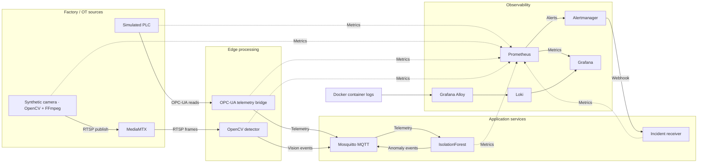

# Computer Vision — Industrial AI & OT Monitoring Platform

> A fully local industrial AI simulation combining computer vision, OPC-UA, MQTT, machine learning, observability and incident management.


[](LICENSE)

**[Overview](#overview) · [Architecture](#architecture) · [Quick start](#quick-start) · [Demo](#demo) · [Scenarios](#failure-scenarios) · [Validation](#validation)**

## Overview

This project connects a simulated production line to an operational monitoring stack. A Python PLC exposes machine data through OPC-UA, a synthetic camera publishes real RTSP video, and edge services turn telemetry and images into MQTT events. Local machine learning detects unusual process data, while Prometheus, Grafana, Loki and Alertmanager bring together metrics, logs, alerts and incident notifications.

The environment runs in Docker Compose with separate OT and application networks. It is designed to demonstrate the engineering work between a sensor reading and an actionable incident: protocol integration, video processing, service recovery, data freshness and fault diagnosis.

The original idea was inspired by modern industrial AI and computer vision platforms, including systems developed by companies such as Cerrion. This repository is an independent personal project built from scratch for learning, experimentation and portfolio purposes. It has no affiliation with that company and contains none of its proprietary code, architecture, models, datasets or internal information.

**No cloud account, paid API, external model service or API key is required.** The first build downloads open-source dependencies; runtime processing and inference stay local.

## 💡 Why I Built This

I built this project to explore the intersection of cloud engineering, DevOps, SRE, machine learning and industrial systems. I wanted an end-to-end environment where industrial telemetry, computer vision, networking, observability and incident response work together.

It helps me deepen hands-on knowledge of industrial AI, computer vision, OPC-UA and OT networks, local ML inference, observability and infrastructure troubleshooting.

## 🎥 What the platform simulates

Products move along a synthetic conveyor while two complementary views of the line are monitored:

- **Machine telemetry:** conveyor speed, motor temperature, vibration, production count, blocked sensor, quality score and line status.
- **Camera observations:** a red obstruction during a jam, reduced brightness, blurred images, lens obstruction and stream loss.

OpenCV analyzes decoded video frames. An IsolationForest model evaluates incoming process telemetry. Prometheus evaluates alert rules, Alertmanager delivers firing and resolved notifications, and a local FastAPI receiver records their latest state. Grafana provides a provisioned view of the process, network health, anomalies, incidents and container logs.

### Architecture



`opcua-sim`, `camera-sim` and `mediamtx` live on **`ot_net`**. The bridge and CV detector join both **`ot_net`** and **`cloud_net`**; backend services primarily use `cloud_net`. Prometheus, Blackbox Exporter and the optional tools container also join both networks to observe OT endpoints.

This makes it possible to disconnect an edge service from OT while preserving its application connection and leaving the PLC running. Docker networks demonstrate logical segmentation; they do not replace industrial firewalls, VLANs or a plant DMZ.

## Engineering focus

| Area | Demonstrated capabilities |
|---|---|
| Industrial IoT / OT | OPC-UA address spaces, dynamic namespace resolution, subscriptions, secure channels and network-path isolation |
| Computer vision / ML | RTSP decoding, interpretable image statistics, reproducible model training and per-message inference |
| DevOps / platform engineering | Containerized Python services, Compose networks, persistent volumes, automatic provisioning and CI checks |
| SRE / incident response | Dependency retries, freshness metrics, HTTP/TCP probes, alert routing, log correlation and recovery testing |

## Quick start

### Requirements

- Docker Engine with Compose v2 or later, or Docker Desktop.
- Plan for approximately **6–8 GB of memory** available to Docker and several GB of disk space.
- Git to clone the repository. **Python 3 on the host is needed only for the scenario scripts and integration runner**, not for the main stack.
- Internet access for the initial image and package downloads.

Replace `<repository-url>` with this repository's actual clone URL:

```bash
git clone <repository-url>
cd computer-vision
docker compose up -d --build
docker compose ps
docker compose --profile tools run --rm tools python /tools/smoke_test.py
```

Allow services to initialize before exploring the dashboard. The smoke test retries checks and expects the platform to be in its normal state.

Open **[Grafana](http://localhost:3000)** and sign in with **`admin` / `admin`**. The **Industrial Computer Vision & OT Lab** dashboard and its Prometheus/Loki data sources are provisioned automatically. The dashboard UID is `industrial-computer-vision`.

No `.env` file is required. [.env.example](.env.example) documents optional `COMPOSE_PROJECT_NAME` and `LOG_LEVEL` settings. All published ports bind to **127.0.0.1**; the credentials are for local use only.

<a id="demo"></a>

## 📸 Demo

Prepare a live production jam for screenshots:

```bash
./scripts/demo_screenshots.sh jam
```

The helper starts the stack, records a normal baseline, invokes the existing scenario controller, and waits for jam metrics and firing alerts before printing the camera, Grafana, Alertmanager and incident URLs. It prepares the demo; screenshots are captured manually. Python 3 and Docker are required.

**Screenshot captures are not included yet.** The intended gallery follows the incident from the camera to operational impact and alert propagation:

| View | What to capture | Save as |
|---|---|---|
| Synthetic camera | A red obstruction on the conveyor during a production jam | `docs/images/camera-jam.png` |
| Grafana | Blocked line, conveyor speed drop, increased vibration, reduced quality and CV/ML anomalies | `docs/images/grafana-jam.png` |
| Alertmanager | Firing production, vision and ML alerts | `docs/images/alertmanager-jam.png` |

<!-- SCREENSHOT GALLERY: Enable only after all three real PNG files exist.
Replace the pending-images note and checklist above with this gallery.

### Production jam detected by the synthetic camera


A visible obstruction connects the camera scene to the simulated blocked-line condition.

### Operational impact in Grafana


Process metrics, vision signals and ML inference show the operational impact of the same incident.

### Alert propagation


Firing alerts make the detected conditions visible to the incident-response workflow.
-->

See the [capture guide](docs/images/README.md) for exact views, Grafana settings and gallery activation. On macOS, `./scripts/demo_screenshots.sh jam --open` optionally opens the URLs. Windows users can run `./scripts/demo_screenshots.ps1 jam`.

When finished, run `./scripts/demo_screenshots.sh normal` (or the PowerShell equivalent). The helper leaves the jam active until you restore normal operation.

## ▶️ Demo Flow

Open the [camera view](http://localhost:8888/line1/), Grafana and the [incident feed](http://localhost:8090/alerts), then run from the started stack:

```bash
./scripts/labctl.sh normal
./scripts/labctl.sh jam
```

The conveyor slows, the blocked sensor activates and a red object appears in the video. CV detects the object; ML can flag the changed process telemetry. Allow roughly 40 seconds for the relevant alerts to reach the incident receiver.

Restore normal operation:

```bash
./scripts/labctl.sh normal
```

On Windows, use `./scripts/labctl.ps1 jam` and `./scripts/labctl.ps1 normal` in PowerShell. Both wrappers call the same Python controller.

## Services and interfaces

The default stack contains **14 running services**, plus an on-demand `tools` service.

| Service | Role | Local interface / published ports |
|---|---|---|
| `opcua-sim` | PLC simulation and control | OPC-UA `4840` · [API docs](http://localhost:8081/docs) · metrics `9101` |
| `camera-sim` | Synthetic conveyor video | [API docs](http://localhost:8082/docs) · metrics `9105` |
| `mediamtx` | RTSP and HLS distribution | RTSP `8554` · [HLS video](http://localhost:8888/line1/) |
| `telemetry-bridge` | OPC-UA reads → MQTT | Metrics `9102` |
| `cv-detector` | Video analysis → MQTT and metrics | Metrics `9104` |
| `ml-anomaly` | Telemetry inference → MQTT and metrics | Metrics `9103` |
| `mqtt` | Eclipse Mosquitto broker | MQTT `1883` |
| `prometheus` | Metrics and alert evaluation | [localhost:9090](http://localhost:9090) |
| `blackbox-exporter` | HTTP and TCP probes | [localhost:9115](http://localhost:9115) |
| `alertmanager` | Alert grouping and webhook delivery | [localhost:9093](http://localhost:9093) |
| `incident-receiver` | Latest firing/resolved incident states | [Alerts](http://localhost:8090/alerts) · [API docs](http://localhost:8090/docs) · metrics `9106` |
| `loki` | Local log storage | [Readiness](http://localhost:3100/ready) |
| `alloy` | Docker log discovery and collection | [localhost:12345](http://localhost:12345) |
| `grafana` | Provisioned operations dashboard | [localhost:3000](http://localhost:3000) |
| `tools` | Protocol clients and smoke tests | Compose profile `tools`; no published ports |

Application metrics are available at `/metrics` on ports `9101`–`9106`.

```text
OPC-UA  opc.tcp://localhost:4840/computer-vision/server/
RTSP    rtsp://localhost:8554/line1
HLS     http://localhost:8888/line1/
```

HLS playback has more latency than RTSP and depends on browser support.

## Failure scenarios

Run any command below with `./scripts/labctl.sh <command>` or `./scripts/labctl.ps1 <command>`.

| Command | Behavior |
|---|---|
| `normal` | Start PLC, camera and edges as needed; restore both OT connections; clear overrides and reset both scenarios |
| `jam` | Block the line, slow the conveyor, increase vibration, reduce quality and display a red obstruction |
| `overheat` | Set motor temperature to 95 °C; keep the camera normal |
| `vibration` | Set motor vibration to 1.2 g |
| `quality-drop` | Reduce quality score to 0.65 |
| `stopped` | Stop the conveyor and set line status to `STOPPED` |
| `dirty-camera`, `dark-camera`, `blur-camera` | Change the camera image without modifying PLC telemetry |
| `camera-offline`, `camera-online` | Stop/start the camera simulator while MediaMTX stays available |
| `opcua-down`, `opcua-up` | Stop/start the PLC simulator; exercise bridge reconnection |
| `edge-ot-cut`, `edge-ot-restore` | Remove/restore only the bridge's OT network connection |
| `cv-ot-cut`, `cv-ot-restore` | Remove/restore only the CV detector's OT network connection |
| `state` | Show Compose service status and PLC/camera API state |

PLC scenarios reset the camera to normal except for `jam`, which changes both sources. Network operations discover resources through Compose labels rather than fixed container names.

For a network diagnosis example, inject `edge-ot-cut` and compare `bridge_opcua_connected` with `probe_success{instance="opcua-sim:4840"}`. The bridge loses access even though Blackbox can still reach the PLC. **Endpoint availability and end-to-end connectivity are different signals.**

<details>
<summary>Manual PLC overrides and dependency recovery</summary>

```bash
curl -X POST http://localhost:8081/override/MotorTemperature \
  -H 'Content-Type: application/json' \
  -d '{"value":105}'

curl -X DELETE http://localhost:8081/overrides
```

The PLC and camera APIs also expose `GET /healthz`, `GET /state` and `POST /scenario/{name}`. The camera health endpoint describes its control plane; `camera_publisher_up` and `cv_stream_up` describe video-path health.

To restore after manually stopping MQTT or MediaMTX, start those dependencies before resetting the scenarios:

```bash
docker compose start mediamtx mqtt
./scripts/labctl.sh normal
```

</details>

## Computer vision and machine learning

### Frame analysis

The camera generates **640 × 360 frames at 10 fps**. FFmpeg encodes H.264 and publishes to MediaMTX over RTSP/TCP; the CV service analyzes actual decoded frames with OpenCV.

| Condition | Detection method | Metric |
|---|---|---|
| Red obstruction | HSV red-pixel ratio > 0.025 | `cv_red_pixel_ratio` |
| Dark image | Mean brightness < 25 | `cv_frame_brightness` |
| Blurred image | Laplacian variance < 30, when not dark | `cv_laplacian_variance` |
| Dirty/obstructed view | Center-to-border brightness ratio < 0.25, when not dark | `cv_center_to_border_brightness_ratio` |
| Stream unavailable | Frame acquisition fails | `cv_stream_up` |

These CPU-friendly heuristics are interpretable and calibrated to the synthetic scene. They are not a trained object-detection model or a claim of accuracy on real factory cameras.

### Process anomaly detection

The ML service trains **scikit-learn IsolationForest** at startup on 4,000 synthetic normal observations with seed `42`, 160 trees and contamination `0.12`. It evaluates each telemetry message using `ConveyorSpeed`, `MotorTemperature`, `Vibration`, `QualityScore` and `BlockedSensor`.

`ml_anomaly_score` is the negative of `decision_function`: **positive values indicate an anomaly**. It is not a probability. The contamination setting selects a sensitive boundary within the training distribution; it does not represent a measured factory failure rate.

False positives and false negatives are possible, including intermittent misses during overheating. Deterministic process alerts remain independent of ML. The model demonstrates local inference integrated into an OT pipeline, not production-grade anomaly detection.

## OPC-UA and MQTT

The PLC address space is `Objects → Factory → Line1`, under namespace **`urn:computer-vision:factory`**. Each variable has a stable String NodeId such as `ns=<resolved-index>;s=Line1.MotorTemperature`; clients resolve the namespace index dynamically.

| Variable | Typical normal value |
|---|---|
| `ConveyorSpeed` | ~1.20 m/s |
| `MotorTemperature` | ~45 °C |
| `Vibration` | ~0.12 g |
| `BottleCount` | Increases during production; resets on PLC restart |
| `BlockedSensor` | `false` |
| `QualityScore` | ~0.985 |
| `LineStatus` | `RUNNING` |

The bridge performs grouped reads every second. A separate diagnostic client demonstrates OPC-UA subscriptions and monitored-item notifications.

| MQTT topic | Publisher | Payload purpose |
|---|---|---|
| `factory/line1/telemetry` | `telemetry-bridge` | Timestamp, site, line and process values |
| `factory/line1/cv/anomaly` | `cv-detector` | Anomaly status, reasons and frame metrics when available |
| `factory/line1/ml/anomaly` | `ml-anomaly` | Anomaly status, score and input timestamp |

Use the tools container for protocol inspection:

```bash
docker compose --profile tools run --rm tools python /tools/opcua_browse.py
docker compose --profile tools run --rm tools python /tools/opcua_secure_read.py
```

For continuous output, run `opcua_subscribe.py` or `mqtt_tail.py` with the same command prefix; stop with Ctrl+C.

<details>
<summary>Secure OPC-UA and certificate pinning</summary>

The server supports `NoSecurity`, `Basic256Sha256 Sign` and `Basic256Sha256 SignAndEncrypt`. Server certificates are generated automatically in a persistent volume; tools generate their own client certificates. Server private keys are not shared with clients.

The secure-read tool establishes a real SignAndEncrypt channel. By default, it discovers the server certificate rather than independently verifying its identity. The server also uses permissive demo certificate handling, not a production trust list.

To supply a server certificate explicitly:

```bash
mkdir -p certs
docker compose cp opcua-sim:/certs/server.der certs/server.der
docker compose --profile tools run --rm \
  -v "$PWD/certs/server.der:/trust/server.der:ro" \
  -e OPCUA_SERVER_CERT=/trust/server.der \
  tools python /tools/opcua_secure_read.py
```

To exercise pinned Sign/SignAndEncrypt reads and a mismatched-certificate failure:

```bash
docker compose --profile tools run --rm \
  -v "$PWD/certs/server.der:/trust/server.der:ro" \
  tools python /tools/opcua_security_test.py
```

The self-signed certificates last one year; automatic renewal and production PKI lifecycle management are not implemented. A successful TCP probe does not prove that an OPC-UA session or certificate check will succeed.

</details>

## 📊 Observability and incident flow

The provisioned dashboard groups **Factory Process**, **OT / OPC-UA**, **Computer Vision**, **Machine Learning**, **Network / Connectivity**, **Alerts / Incidents** and a Docker logs panel.

Prometheus scrapes every five seconds. Its 11 rules cover connection loss, overheating, vibration, blocked production, quality degradation, camera loss, CV/ML anomalies, stale telemetry, failed probes and unavailable exporters. Rules wait 10–20 seconds before firing; Alertmanager groups notifications and sends both firing and resolved webhooks to `/webhook` on the incident receiver.

Blackbox probes the PLC, camera and incident HTTP APIs, Loki readiness, and TCP listeners for OPC-UA, RTSP and MQTT. Alloy discovers labeled Docker containers and sends their logs to Loki with `compose_service`, `project`, `container` and `platform` labels.

### Useful queries

| Question | PromQL |
|---|---|
| What is the motor temperature? | `factory_motor_temperature_c` |
| Can the bridge read the PLC? | `bridge_opcua_connected` |
| Is video being decoded? | `cv_stream_up` |
| Is ML flagging the latest sample? | `ml_anomaly_detected` |
| Is ML input fresh? | `time() - ml_last_input_timestamp_seconds` |
| How fast is telemetry being published? | `rate(bridge_messages_published_total[1m])` |
| Which endpoint probes fail? | `probe_success == 0` |
| How many incidents are firing? | `incident_active_alerts` |

In Grafana Explore, select Loki and filter by service:

```logql
{platform="docker", compose_service="telemetry-bridge"}
```

ML and image statistics retain their last values during input loss. Check `ml_last_input_timestamp_seconds`, `cv_stream_up` and `cv_last_frame_timestamp_seconds` before interpreting them. The ML alert excludes stale input; a separate rule covers missing telemetry.

Prometheus and Loki use local volumes with seven-day retention. The incident receiver keeps the latest state of up to 1,000 alert identities **in memory**, so its records are lost on restart. `factory_bottle_count_total` is a gauge of the simulated PLC counter, despite its suffix; `factory_line_status` encodes stopped/running/blocked as `0`/`1`/`2`.

## Repository structure

```text
.
├── docker-compose.yml        # Services, localhost ports, volumes and networks
├── Dockerfile                # Shared non-root Python image
├── requirements.txt          # Pinned direct Python dependencies
├── common/                   # Wire contracts, MQTT, certificates and logging
├── services/
│   ├── opcua_sim/            # PLC and FastAPI controls
│   ├── camera_sim/           # Animated conveyor and FFmpeg publisher
│   ├── telemetry_bridge/     # OPC-UA → MQTT
│   ├── cv_detector/          # RTSP decoding and image analysis
│   ├── ml_anomaly/           # IsolationForest training and inference
│   └── incident_receiver/    # Alertmanager webhook intake
├── tools/                    # Protocol clients and smoke tests
├── scripts/                  # Scenario control, demo preparation and validation
├── tests/                    # Vision and ML unit tests
├── grafana/                  # Dashboard and data-source provisioning
├── prometheus/               # Scrapes, alerts and Blackbox configuration
├── alertmanager/             # Notification routing
├── alloy/                    # Docker log collection
├── loki/                     # Local log storage configuration
├── mediamtx/                 # RTSP/HLS configuration
├── mosquitto/                # MQTT broker configuration
├── docs/
│   ├── VALIDATION.md         # Recorded runtime results and test limitations
│   └── images/              # Screenshot capture guide and intended PNG location
├── .github/workflows/ci.yml   # Static, unit and configuration checks
├── .env.example              # Optional Compose project name and log level
├── Makefile                  # Build, lifecycle and scenario shortcuts
├── SOURCES.md                # Official upstream references
└── LICENSE                   # MIT license for original project code
```

## Validation

The [local validation record](docs/VALIDATION.md) documents successful builds, six unit tests, secure OPC-UA reads, MQTT round trips, RTSP/HLS checks, monitoring integration and failure recovery on macOS arm64 with Docker Desktop. It also records untested areas, including Windows execution and browser visual rendering. These are recorded results, not a live CI status badge.

After the initial build, run repository checks and unit tests through the tools image:

```bash
make validate
make test
```

Run the full smoke test against a normal, running stack:

```bash
docker compose --profile tools run --rm tools python /tools/smoke_test.py
```

The smoke test checks HTTP/TCP endpoints, real OPC-UA reads and encryption, MQTT publishing/subscriptions, RTSP decoding, Prometheus targets/probes, Grafana provisioning and Alloy-to-Loki logs. Failures return a nonzero exit code.

For automated failure injection and recovery, run:

```bash
python3 scripts/integration_test.py
```

This temporarily disrupts the local stack, checks recovery and restores normal in a `finally` block. It covers process faults, camera degradation, PLC/camera outages, OT network cuts, MediaMTX loss and MQTT loss.

The [GitHub Actions workflow](.github/workflows/ci.yml) defines Python, YAML, JSON, shell/PowerShell, Compose, unit-test and monitoring configuration checks. Full runtime integration is a local test; the workflow itself has not yet been verified on GitHub.

## Operations and security

The bridge, CV detector and camera publisher retry temporary dependency failures. MQTT clients reconnect with bounded queues and a 1–15 second retry delay. This demonstrates service resilience, but does not guarantee lossless buffering or exactly-once delivery.

**This configuration is intended for local development and demonstration.** It includes anonymous MQTT, `admin/admin` Grafana credentials, self-signed OPC-UA certificates and unauthenticated internal APIs. Python services run without root; Alloy accesses the Docker socket. A `:ro` socket mount does **not** make Docker API operations read-only.

Production deployment would require managed secrets, authentication and RBAC, MQTT TLS/mTLS, certificate trust and rotation, OT firewall/ACL policies, restricted Docker access, image hardening and scanning, backups and audit logging. The shared Python image simplifies this project but includes CV/ML dependencies that could be split into smaller service-specific images.

Useful lifecycle commands:

```bash
docker compose logs -f --tail=100 telemetry-bridge cv-detector
docker compose down
```

`docker compose down` retains named volumes. **`docker compose down -v` or `make clean` deletes stored data and demo server certificates.** Other shortcuts include `make build`, `make up`, `make ps`, `make logs`, `make smoke` and scenario targets such as `make jam`.

## 🗺️ Roadmap

These are **future improvements**, not features currently implemented:

- Support a real webcam or IP camera and a local object-detection model such as YOLO.
- Integrate a real OPC-UA device or PLC.
- Extend the simulation to multiple production lines and sites.
- Add GPU-accelerated inference.
- Build richer Grafana incident views and persistent incident history.
- Add historical ML/anomaly analysis and a more complete MLOps/model lifecycle workflow.
- Introduce more advanced OT network failure scenarios.

## License and references

Original project code is released under the [MIT License](LICENSE). Third-party components retain their upstream licenses. See [SOURCES.md](SOURCES.md) for official documentation and project references.
